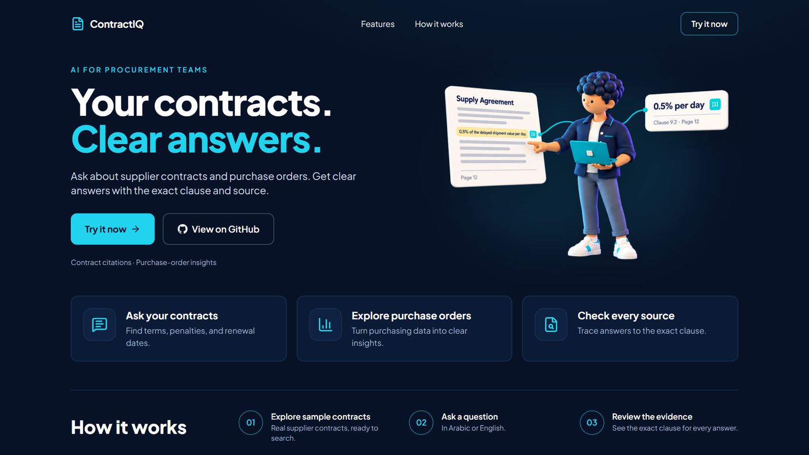
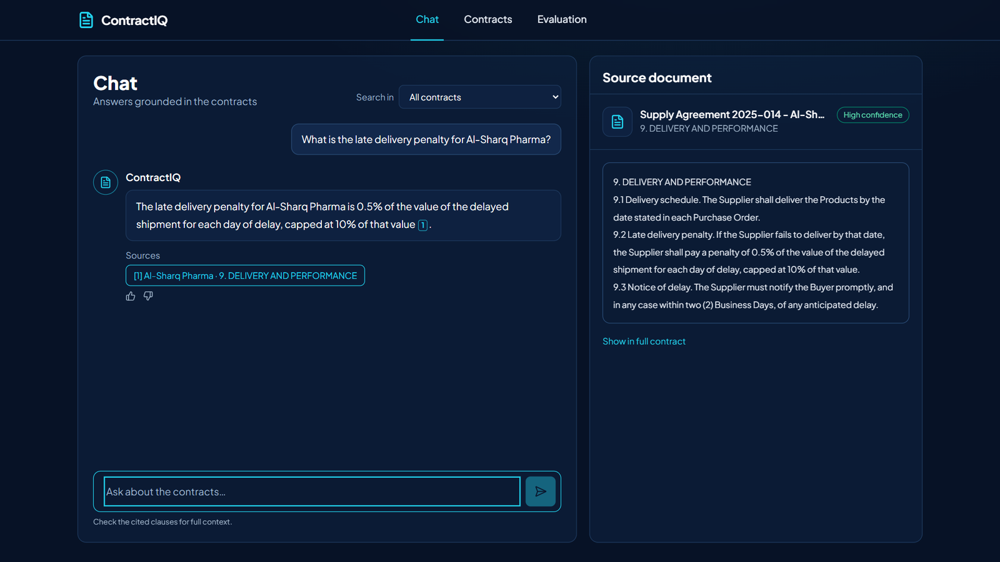
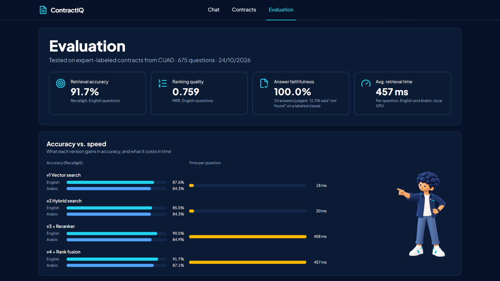

# ContractIQ

ContractIQ is a RAG (Retrieval-Augmented Generation) assistant for procurement teams. You ask
a question about a supplier contract in English or Arabic, and it answers with the exact clause
the answer came from.



## How it works

The contracts are split into clauses and stored as embeddings. When you ask a question, the
system runs a hybrid search, by meaning and by keywords, then a reranker rereads the best
matches to pick the most relevant one. The language model writes the answer using only those
clauses and cites them. Questions about numbers, such as how many orders arrived late, go
through Text-to-SQL on the purchase-order database instead. If the contracts don't contain the
answer, the assistant says so rather than guessing.



## Results

The retrieval was tested on 675 questions over real contracts labeled by lawyers (the CUAD
dataset). It finds the right clause 91.7% of the time in English and 87.1% in Arabic.



## Built with

Python, FastAPI, PostgreSQL with pgvector, BGE-M3 and React.

## Run it

You need Docker, Python 3.12+ and Node.js. A GPU makes search faster but isn't required.

1. Download the CUAD dataset (CUAD_v1.zip) from https://zenodo.org/records/4595826
   and unzip it into `data/raw/cuad/`.
2. Copy `.env.example` to `.env` and add your Gemini API key.
3. Start the database and install everything:

   ```bash
   docker compose up -d
   pip install -r requirements.txt -e .
   cd frontend && npm install && npm run build && cd ..
   ```

4. Load the contracts and build the search index:

   ```bash
   python -m contractiq.ingest
   python -m contractiq.synthetic
   python -m contractiq.embed
   ```

5. Start the app and open http://localhost:8000

   ```bash
   uvicorn contractiq.api:app
   ```
